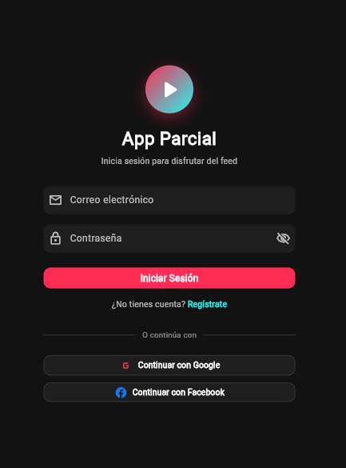
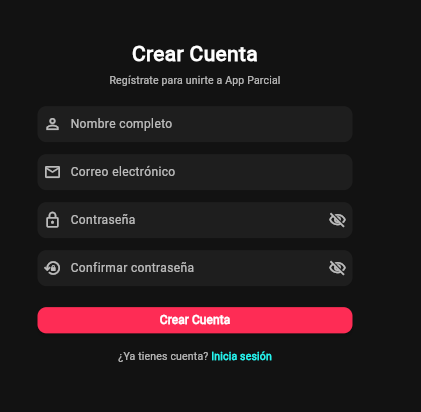
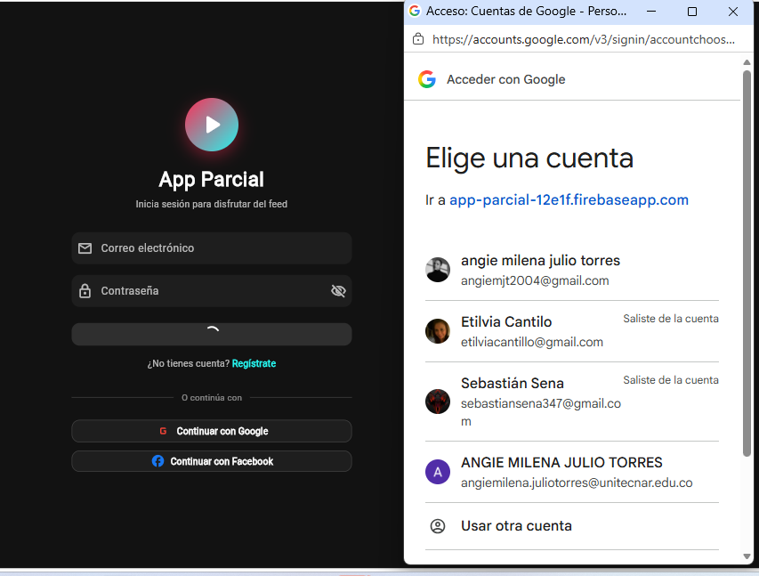
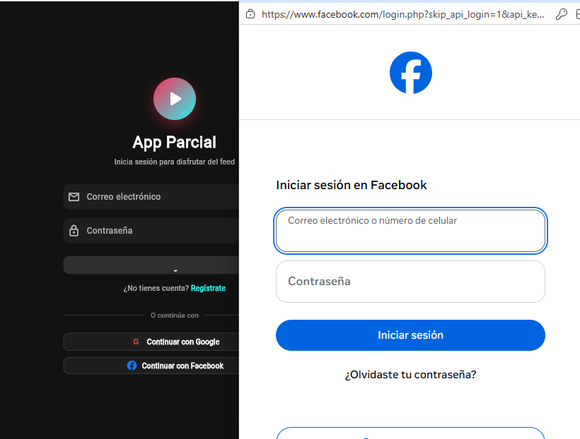

# App Parcial - Flutter + Firebase + TikTok Feed

Aplicación móvil y web desarrollada en **Flutter** con autenticación multicanal en **Firebase**, enrutamiento reactivo con **GoRouter** y un reproductor de videos verticales a pantalla completa interactivo estilo **TikTok**.

---

## 📱 Características Principales

### 1. Autenticación con Firebase
- **Correo y Contraseña**:
  - **Login (`/login`)**: Formulario con validación de campos obligatorios y formato de email. Gestión detallada de errores (usuario no encontrado, credenciales incorrectas, demasiados intentos, cuenta deshabilitada).
  - **Registro (`/registro`)**: Formulario con validación de nombre completo, formato de correo, contraseña mínima de 6 caracteres y confirmación exacta de contraseñas. Crea la cuenta mediante `createUserWithEmailAndPassword` y almacena el nombre con `updateDisplayName`.
- **Inicio de Sesión con Google**:
  - Integración mediante `GoogleAuthProvider` (Web) y `google_sign_in` (móvil).
- **Inicio de Sesión con Facebook**:
  - Integración mediante `FacebookAuthProvider` (Web) y `flutter_facebook_auth` (móvil).
- **Cierre de Sesión Unificado**:
  - Botón de Logout en el feed que muestra el nombre o correo del usuario conectado y revoca las sesiones activas en Firebase, Google y Facebook simultáneamente.

### 2. Enrutamiento Protegido con `go_router`
- **Rutas configuradas**:
  - `/login` (Vista inicial predeterminada sin sesión)
  - `/registro` (Formulario de nueva cuenta)
  - `/feed` (Feed estilo TikTok protegido)
- **Lógica de `redirect`**:
  - **Sin sesión iniciada**: Únicamente se permite acceder a `/login` y `/registro`. Si el usuario intenta navegar a `/feed` u otra ruta protegida, es redirigido automáticamente a `/login`.
  - **Con sesión iniciada**: Al autenticarse (por correo, Google o Facebook), la aplicación redirige de forma reactiva a `/feed`. Cualquier intento de volver a `/login` o `/registro` redirige directamente al `/feed`.

### 3. Feed de Videos Vertical Estilo TikTok (`/feed`)
- **PageView Vertical**: Desplazamiento vertical fluido entre al menos 4 videos en pantalla completa (`BoxFit.cover`).
- **Reproducción Inteligente**: Reproducción automática **exclusiva** del video visible en pantalla; los videos anteriores o siguientes se pausan automáticamente al deslizar.
- **Control Táctil**: Tocar la pantalla alterna entre reproducir y pausar con un indicador animado translúcido en el centro.
- **Interfaz Superpuesta (Overlay)**:
  - Nombre del creador con insignia de verificación.
  - Descripción del video con etiquetas y hashtags.
  - Audio original con pista musical.
  - Contador de **Me Gusta** interactivo (cambia a rojo e incrementa el contador al pulsar).
  - Botón de **Comentarios** que abre una hoja inferior interactiva (Bottom Sheet).
  - Botón de **Compartir** con notificación flotante.
  - Disco de música giratorio animado que rota al ritmo de la reproducción.
- **Barra Superior**: Pestañas "Siguiendo" / "Para ti", chip con el nombre/correo del usuario autenticado y botón de Logout con modal de confirmación.

---

## 🛠️ Tecnologías y Paquetes Utilizados

| Paquete | Versión | Propósito |
| :--- | :--- | :--- |
| `flutter` | 3.47+ / SDK Dart 3.13+ | Framework principal multiplataforma |
| `go_router` | ^18.1.4 | Navegación declarativa y guards de redirección reactiva |
| `firebase_core` | ^5.2.0 | Inicialización del ecosistema Firebase |
| `firebase_auth` | ^7.1.0 | Autenticación y gestión de usuarios |
| `google_sign_in` | ^6.2.1 | Autenticación con cuentas de Google |
| `flutter_facebook_auth` | ^7.3.3 | Autenticación con cuentas de Facebook |
| `video_player` | ^2.14.1 | Reproducción de videos y streaming multimedia |

---

## ⚙️ Configuración de Firebase

El proyecto ya está vinculado con Firebase CLI al proyecto `app-parcial-12e1f` y cuenta con el archivo generado `lib/firebase_options.dart`.

### Habilitar Métodos en Firebase Console:
1. Ingresa a la consola de Firebase: [https://console.firebase.google.com/project/app-parcial-12e1f/authentication/providers](https://console.firebase.google.com/project/app-parcial-12e1f/authentication/providers).
2. Dirígete a **Build > Authentication > Sign-in method**:
   - **Correo electrónico/Contraseña**:
     - Clic en "Correo electrónico/contraseña", activa el interruptor y pulsa **Guardar**.
   - **Google**:
     - Clic en "Google", activa el interruptor, asigna un correo de asistencia técnica y pulsa **Guardar**.
   - **Facebook**:
     - Clic en "Facebook", activa el interruptor.
     - Ingresa tu **ID de la aplicación** y **Secreto de la aplicación** obtenidos desde [Meta for Developers](https://developers.facebook.com/).
     - Copia el URI de redireccionamiento de OAuth proporcionado por Firebase y pégalo en la configuración de inicio de sesión con Facebook en Meta.

---

## 🚀 Instrucciones para Ejecutar la Aplicación

### 1. Clonar el repositorio e instalar dependencias
```bash
git clone <URL_DEL_REPOSITORIO>
cd app-parcial
flutter pub get
```

### 2. Ejecutar pruebas unitarias
```bash
flutter test
```

### 3. Ejecutar en Navegador Web (Chrome o Edge)
```bash
flutter run -d chrome
```

### 4. Compilar para Producción Web
```bash
flutter build web
```

---

---

## 🎥 Video Demostrativo de Funcionamiento

> [!TIP]
> Demostración en video del registro, los tres métodos de inicio de sesión y la navegación del feed vertical estilo TikTok:
> 
> 🔗 **Enlace al Video:** [👉 Haz clic aquí para ver el video demostrativo]((https://drive.google.com/file/d/1qrkBTJEgNwb2UrP2lRecWmxv2E8-Cbfo/view?usp=drive_link))
> *(Reemplaza `PEGAR_AQUI_EL_ENLACE_DE_TU_VIDEO` por tu enlace de YouTube, Google Drive, Loom o Teams)*

---

## 📸 Capturas de Pantalla de la Aplicación

### 1. Vista de Login (`/login`)
Formulario de inicio de sesión con validación de campos obligatorios, formato de correo, enlaces de navegación y botones sociales.

<p align="center">
  
</p>

---

### 2. Vista de Registro (`/registro`)
Formulario para crear cuenta con nombre completo, correo, contraseña (mínimo 6 caracteres) y validación de confirmación coincidente. Al completarse, inicia sesión en Firebase y redirige automáticamente al `/feed`.

<p align="center">
  
</p>

---

### 3. Métodos de Inicio de Sesión Social (Google y Facebook)
Integración y autenticación con Firebase mediante ventanas emergentes (OAuth Popups):

#### Inicio de sesión con Google
<p align="center">
  
</p>

#### Inicio de sesión con Facebook
<p align="center">
  
</p>

---

### 4. Feed de Videos Vertical Estilo TikTok (`/feed`)
- Desplazamiento vertical fluido entre los 4 videos (`PageView.builder`).
- Reproducción automática exclusiva del video enfocado y pausa/reanudación al tocar la pantalla.
- Insignia de creador, descripción, audio, likes interactivos (cambian a rojo), panel inferior de comentarios y disco musical giratorio.
- Barra superior con nombre o correo del usuario activo y botón de Logout multisesión.

<p align="center">
  <i>(Puedes adjuntar aquí una captura o GIF del feed: <code>screenshots/feed.png</code> o ver el video demostrativo en la sección superior)</i>
</p>

---

## 📦 Instrucciones para Subir a GitHub

Para subir el proyecto a un repositorio nuevo en GitHub:

```bash
# 1. Inicializar git si es necesario
git init

# 2. Agregar todos los archivos
git add .

# 3. Crear el commit inicial
git commit -m "Entrega Parcial: Flutter + Firebase Auth + GoRouter + TikTok Feed"

# 4. Vincular con el repositorio remoto de GitHub
git branch -M main
git remote add origin https://github.com/<TU_USUARIO>/<TU_REPOSITORIO>.git

# 5. Subir los cambios
git push -u origin main
```

---

## 👨‍💻 Autor
Proyecto desarrollado para la materia de Ingeniería de Software.
